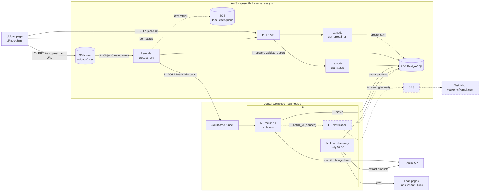
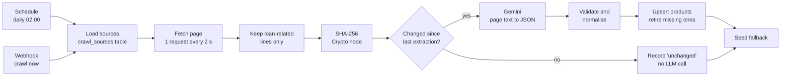
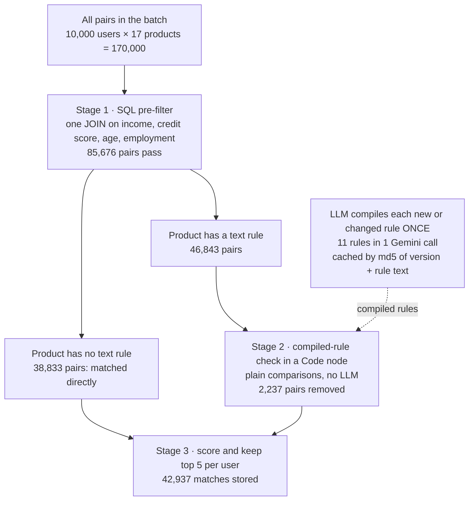

# Loan Eligibility Engine

Upload a CSV of users, and the system finds the personal loan products each user is likely eligible for and tells them. CSV ingestion runs on AWS (S3, Lambda, RDS PostgreSQL). Product discovery, matching and notification run as workflows in a self-hosted **n8n** instance, with Gemini used only where free text has to be understood.

**Measured on the 10,000-user sample:**
- **On AWS:** the file goes from the browser to S3 to RDS in under 10 s. The Lambda streams and saves all 10,000 rows in 2.3 s, using 110 MB of memory. Matching then runs in n8n.
- **Locally:** matching all 170,000 user-product pairs takes 4 s and makes **no LLM calls**, because each product's free-text rule is compiled by the LLM once and then checked in plain code ([details](#optimization-treasure-hunt-workflow-b)).

| Part | State |
|---|---|
| Scalable CSV ingestion (presigned S3 upload, streaming Lambda, chunked upserts) | Done, tested locally |
| Upload page (`ui/index.html`) | Done |
| `serverless.yml` (API, Lambdas, S3, RDS, DLQ, SES user) | **Deployed to AWS (ap-south-1)** and tested end to end |
| Workflow A: loan product discovery (crawler) | Done |
| Workflow B: matching with the optimised funnel | Done |
| Workflow E: error handler for A and B | Done |
| Workflow C: email notification via SES | Designed, **not built yet** |

---

## Contents

- [Architecture](#architecture)
- [Repository layout](#repository-layout)
- [Run it locally](#run-it-locally)
- [Configure n8n credentials](#configure-n8n-credentials)
- [Deploy to AWS](#deploy-to-aws)
- [Design decisions](#design-decisions)
  - [Ingestion](#ingestion)
  - [Workflow A: crawling strategy](#workflow-a-crawling-strategy)
  - [Optimization Treasure Hunt (Workflow B)](#optimization-treasure-hunt-workflow-b)
  - [Workflow C: notification (planned)](#workflow-c-notification-planned)
  - [Workflow E: error handling](#workflow-e-error-handling)
  - [Security](#security)
- [AWS test run](#aws-test-run)
- [Networking and production considerations](#networking-and-production-considerations)
- [Tests](#tests)
- [Limitations and next steps](#limitations-and-next-steps)

---

## Architecture



One upload, end to end:

1. The page asks the API for an upload link. `get_upload_url` records the batch and returns a **presigned S3 URL**: a 5-minute permission to PUT one file to `uploads/<batch_id>.csv`.
2. The browser uploads the file **straight to S3**. File bytes never pass through API Gateway or a Lambda payload.
3. S3 emits `ObjectCreated`, which starts `process_csv`.
4. `process_csv` streams the file, validates each row, and upserts users into RDS in chunks of 2,000. Rejected rows are written to `rejected/<batch_id>.csv`.
5. It calls n8n's Workflow B webhook through the tunnel, with a shared secret header.
6. Workflow B answers `202` straight away, then matches the batch's users against active products and stores the matches.
7. B hands the batch to Workflow C (planned).
8. C emails each matched user's products through SES, to test-inbox aliases only (planned).

Workflow A runs independently every night and keeps `loan_products` current. Dashed lines are planned and not built yet.

---

## Repository layout

```
├── serverless.yml            AWS stack: HTTP API, 3 Lambdas, S3, RDS, SQS DLQ, SES-only IAM user
├── docker-compose.yml        app Postgres (local stand-in for RDS), n8n, n8n's own Postgres
├── src/
│   ├── handlers/             Lambda entry points: get_upload_url, process_csv, get_status
│   └── lib/                  validation, streaming ingestion, DB connection, n8n webhook client
├── sql/
│   ├── 001_schema.sql        tables (runs automatically on a fresh database)
│   ├── 002_indexes.sql
│   ├── 003_crawl_sources.sql the pages Workflow A crawls
│   └── seed/seed_products.sql illustrative fallback products
├── n8n/
│   ├── workflows/            importable workflow JSON (A, B, E)
│   ├── code/                 JavaScript of each n8n Code node, readable and diffable
│   └── build.py              assembles code + SQL into the workflow JSON
├── ui/index.html             upload page (no build step)
├── scripts/
│   ├── dev_server.py         runs the real handlers locally: a folder in place of S3
│   └── local_ingest.py       ingest a CSV from disk, no AWS involved
├── tests/                    pytest: validation, ingestion against Postgres, key handling
└── data/users.csv            the sample from the brief
```

The n8n workflows are written as source files instead of only being edited in the n8n UI. Each Code node's JavaScript lives in `n8n/code/`, and each SQL query sits in `n8n/build.py` next to the node that runs it. `python n8n/build.py` assembles the importable JSON. That way the logic can be reviewed in a diff, and the JSON in `n8n/workflows/` is always rebuildable.

---

## Run it locally

The brief accepts a local deployment. Locally, Docker Postgres stands in for RDS, and `scripts/dev_server.py` stands in for API Gateway and S3. The handler code is the same code that runs on Lambda.

**Prerequisites:** Docker Desktop, Python 3.11+, Node 18+ (only needed to deploy), a free [Gemini API key](https://aistudio.google.com/apikey).

```bash
git clone <this repo> && cd loan-eligibility-engine
cp .env.example .env
#   set N8N_ENCRYPTION_KEY:  openssl rand -hex 32
#   set N8N_WEBHOOK_SECRET:  openssl rand -hex 24

docker compose up -d                 # app Postgres on localhost:5433, n8n on http://localhost:5678
python3 -m venv .venv && .venv/bin/pip install -r requirements-dev.txt
.venv/bin/pytest                     # 34 tests
```

The schema is created automatically the first time the app database starts.

**Set up n8n:**

1. Open http://localhost:5678 and create the owner account.
2. Create the credentials listed in [Configure n8n credentials](#configure-n8n-credentials).
3. Import and activate the workflows:

```bash
for f in E_error_handler A_loan_discovery B_matching; do
  docker exec loan-engine-n8n n8n import:workflow --input=/workflows/$f.json
done
for id in lnErrorHandlerE1 lnDiscoveryWflA1 lnMatchingWflwB1; do
  docker exec loan-engine-n8n n8n publish:workflow --id=$id
done
docker compose restart n8n
```

Workflow E must be published too. n8n 2.x refuses to run an error workflow that is not active.

When you open each workflow, n8n asks you to pick the matching credential for any node whose credential id differs from the one in the file.

**Load loan products:** either crawl, or load the seed file.

```bash
# crawl now (Workflow A also runs daily at 02:00)
curl -X POST http://localhost:5678/webhook/crawl-now -H "X-Webhook-Secret: $N8N_WEBHOOK_SECRET"

# or load the illustrative seed products
docker exec -i loan-engine-db psql -U loans -d loans < sql/seed/seed_products.sql
```

**Upload a CSV:**

```bash
.venv/bin/python scripts/dev_server.py     # open http://localhost:8000 and drop data/users.csv
```

The page shows each stage as it happens: upload, rows saved and rejected, matching, matches found. To ingest without the page, run `.venv/bin/python scripts/local_ingest.py data/users.csv --trigger`.

**Inspect results:**

```bash
docker exec loan-engine-db psql -U loans -d loans -c "SELECT * FROM match_runs ORDER BY run_id DESC LIMIT 1;"
```

---

## Configure n8n credentials

In n8n: **Overview → Credentials → Create credential**. Names matter only for readability.

| Credential | Type | Fields | Used by |
|---|---|---|---|
| **App DB** | Postgres | Local: host `app-db`, port `5432`, database `loans`, user `loans`, password from `.env`, SSL `disable`.<br/>RDS: host = `DatabaseEndpoint` output of `serverless info --verbose`, port `5432`, database `loans`, user `loans`, password = `RDS_MASTER_PASSWORD`, SSL `require`, **Ignore SSL Issues on**. n8n does not ship Amazon's certificate authority, so it can't verify the RDS certificate; traffic is still encrypted. In production, load the RDS CA bundle instead. | A, B, E |
| **Webhook secret (Lambda to n8n)** | Header Auth | Name `X-Webhook-Secret`, Value = `N8N_WEBHOOK_SECRET` from `.env` | B's webhook, A's "crawl now" webhook |
| **Gemini API key** | Header Auth | Name `x-goog-api-key`, Value = your Gemini key | A (extraction), B (rule compiling) |
| **AWS (SES)** | AWS | Access key of the `N8nSesUser` IAM user (see below), region `ap-south-1` | C (planned) |

Inside Docker, n8n reaches the app database by its service name `app-db`. `localhost` would point at the n8n container itself, and `5433` is only the port published to your Mac.

**SES user:** `serverless.yml` creates an IAM user that may only call `ses:SendEmail` and `ses:SendRawEmail`. To create its key:

```bash
aws iam create-access-key --user-name <N8nSesUserName output> --profile clickpe
```

---

## Deploy to AWS

> Deployed and tested with these steps on 2026-10-12. `serverless deploy` took 534 s, mostly creating RDS. See [the AWS test run](#aws-test-run) for the results.

1. **AWS CLI profile.** Create an IAM user for deploying, then `aws configure --profile clickpe` (region `ap-south-1`). Check it with `aws sts get-caller-identity --profile clickpe`.
2. **Settings in `.env`:**
   - `RDS_MASTER_PASSWORD`: a strong password.
   - `N8N_WEBHOOK_SECRET`.
   - `N8N_WEBHOOK_URL`: n8n's public webhook URL (step 4).
   - Optional: `DB_ALLOWED_CIDR` (who can reach RDS) and `UI_ORIGIN` (who may call the API).
3. **Deploy:**
   ```bash
   npm install
   npx serverless deploy            # about 10 minutes, mostly RDS creation
   npx serverless info --verbose    # API URL, DatabaseEndpoint, UploadBucketName, N8nSesUserName
   ```
4. **Expose n8n so Lambda can reach it** (do this before the first deploy, so the Lambda gets the URL):
   ```bash
   docker compose --profile tunnel up -d tunnel
   docker logs loan-engine-tunnel 2>&1 | grep -o 'https://[a-z0-9-]*\.trycloudflare\.com'
   ```
   Put that address in `.env` as `N8N_PUBLIC_URL=<url>/` and `N8N_WEBHOOK_URL=<url>/webhook/loan-match`, then run `docker compose up -d n8n`. A quick tunnel gets a new address whenever it restarts. When that happens, update `.env` and run `npx serverless deploy` again so the Lambda calls the new address.
5. **Create the schema on RDS:**
   ```bash
   for f in sql/001_schema.sql sql/002_indexes.sql sql/003_crawl_sources.sql; do
     docker run --rm -i postgres:16.4 psql "host=<DatabaseEndpoint> dbname=loans user=loans sslmode=require password=$RDS_MASTER_PASSWORD" < "$f"
   done
   ```
6. **Point n8n at RDS:** edit the *App DB* credential as described above.
7. **Open the page:** `ui/index.html?api=<API URL>`. Host the file anywhere, or open it locally.

To delete everything, run `npx serverless remove`.

---

## Design decisions

### Ingestion

**Problem:** API Gateway rejects request bodies over 10 MB and times out at about 30 s, and a Lambda accepts at most a 6 MB payload. The 10,000-row sample is 1 MB, so 100k rows is already about 10 MB.

**Approach: presigned URL and S3 event.**
- The API only issues a short-lived, single-key, PUT-only signed URL. The browser uploads the bytes directly to S3, which accepts up to 5 GB in a single PUT.
- S3's `ObjectCreated` event then starts `process_csv`. Nothing polls, and nothing sits idle waiting for files.

**How `process_csv` stays fast and safe:**
- **It streams.** The S3 body is decoded incrementally and parsed row by row; the file is never read into memory whole. Memory holds one 2,000-row buffer, whatever the file size.
- **It writes in chunks.** One `INSERT … ON CONFLICT` per 2,000 rows (`psycopg2.extras.execute_values`): 10,000 rows take 5 statements, not 10,000 round trips. **Measured: 10,000 rows in 0.40 s (about 25,000 rows/s).**
- **It validates each row** (`src/lib/validation.py`):
  - required columns, matched loosely (`Monthly Income` works too)
  - email format
  - income as a number, including `₹1,20,000`
  - credit score 300–900 and age 18–100
  - employment mapped to a fixed set
  - duplicate `user_id`s within a file
  
  A bad row is rejected with a reason and never sinks the file.
- **It is idempotent.** S3 delivers events at least once. The batch id comes from the object key, and users are upserted by `user_id`, so a redelivered event changes nothing.
- **It fails visibly.**
  - An unusable file (missing columns, not UTF-8) is marked `FAILED` and not retried.
  - Unexpected errors are retried by Lambda, then land in an **SQS dead-letter queue**.
  - If n8n is unreachable, the rows stay saved and the batch is marked `WEBHOOK_PENDING` so it can be replayed. The webhook call itself retries three times, waiting 1 s, 2 s and 4 s.
- **It reports progress.** The batch row's counts update after every chunk, so `GET /status/{batch_id}` shows progress while a large file is still loading.

**Beyond one Lambda run:** at the local rate a 15-minute Lambda could load millions of rows; RDS over the network will be slower, so that is an upper bound. For files that outgrow one run, split the object by byte range and fan out through SQS, or use a Step Functions Distributed Map.

### Workflow A: crawling strategy



**Choosing sources.** Each candidate page was checked for whether its `robots.txt` allows crawling it and whether its loan terms appear in the raw HTML; a plain HTTP crawler can't run JavaScript. **BankBazaar**, **Wishfin** and **ICICI Bank** passed both checks. Wishfin was later disabled (see below), leaving two active sources. The rest were rejected:
- Paisabazaar and Bajaj Finserv answer bots with 403.
- HDFC Bank's `robots.txt` disallows its eligibility page.
- SBI's page returned 404 and IDFC FIRST's returned 500.
- Axis Bank's page had almost no figures.

The source list lives in the `crawl_sources` table, so adding or pausing a site is one database row, not a workflow edit.

**Steps and why:**
- **Politeness:** one request at a time, 2 s apart, with an honest `User-Agent`, once a day.
- **Cleaning before the LLM:** HTML is stripped and only lines about rates, income, age, credit score and similar terms are kept, along with the heading line above each. **The three pages drop from 1.8 MB of HTML to 64 KB of text** (about 16,500 tokens), which is cheaper and gives the LLM less noise to misread.
- **Change detection:** the cleaned text is SHA-256 hashed by n8n's Crypto node. An unchanged page skips the LLM entirely. **Measured: an immediate second crawl took 12.5 s instead of 45 s, and only the page that had failed went to Gemini.**
- **Structured extraction:** Gemini is called with a JSON `responseSchema`, temperature 0, and rules such as "use only values stated for that product". When a rule differs by group (salaried age 21–60, self-employed 21–65), the most permissive value goes in the columns and the group-specific limit goes in `extra_criteria_text`. Workflow B's rule compiler then turns that text into a check, so the two workflows fit together without extra code.
- **Validation:**
  - Out-of-range numbers become null, and swapped min/max pairs are put in order.
  - Duplicate products are removed.
  - **A product with no eligibility terms at all is dropped**, because it would match every user.
- **Failure handling:** if a fetch or extraction fails, the page keeps its old hash and is retried on the next run. Products a page no longer lists are deactivated, but only after a successful extraction.
- **Fallback:** `sql/seed/seed_products.sql` holds 20 illustrative products, clearly marked `source_site = 'seed'`. They are active **only while fewer than 5 crawled products are**, so a broken crawl never leaves matching with nothing to work with.

**First crawl, measured:** BankBazaar gave 15 products and ICICI gave 2. Wishfin gave none. Its execution data showed Gemini correctly returning an empty list, because the page has only rates and general advice, with no eligibility terms per lender. Two replacement pages (Wishfin's and BankBazaar's eligibility pages) turned out to be generic as well, so Wishfin is **disabled** in `crawl_sources` rather than costing a wasted LLM call every day. Handling layout changes is optional in the brief. Here, extraction is done by an LLM over cleaned text rather than with CSS selectors, so most layout changes don't break it.

### Optimization Treasure Hunt (Workflow B)

**Problem:** asking an LLM about every user-product pair means 10,000 users × 17 products = **170,000 calls**. At about a second each, that's two days, and far beyond any free quota.

**Key observation:** most eligibility rules are plain comparisons that a database answers in microseconds. The rules that need language understanding are few, and they're attached to **products**, not users. "Self-employed applicants need a credit score of at least 750" means the same thing for every applicant. So the LLM is asked to translate each **rule** once, not to judge each **pair**.



**The stages:**

1. **Scope to the batch.** Only users whose `batch_id` matches the webhook's payload are processed.
2. **SQL pre-filter.** A single set-based JOIN in Postgres removes every pair that fails a numeric or employment rule, and returns one row per user (with an array of candidate product ids) rather than one per pair, so n8n holds 10,000 items instead of 85,676.
3. **Compile the rules, once.** Products whose `extra_criteria_text` changed since it was last compiled go to Gemini **together, in one request**. Each comes back as a structured rule:
   ```json
   { "kind": "eligibility",
     "require": {},
     "conditions": [
       { "when_employment_in": ["self_employed"], "require": { "credit_score_min": 750 },
         "needs_unknown_data": [], "verification_note": "" },
       { "when_employment_in": ["salaried"], "require": { "credit_score_min": 700 },
         "needs_unknown_data": [], "verification_note": "" } ],
     "needs_unknown_data": [], "verification_note": "" }
   ```
   - The output is checked against a strict schema: allowed fields, value ranges, known employment types. Anything malformed is stored as `invalid` and never guessed at.
   - The result is saved with `md5('<compiler version>:' || rule text)`. Editing a rule, a crawler update, or a change to the prompt (via the version) triggers recompilation automatically; nothing else does.
4. **Apply the rules in code.** An n8n Code node checks each candidate pair against its compiled rule.
   - Rules that depend on facts the CSV doesn't contain, such as employer type, city or years in business, are not guessed. The match is kept and records what the lender will verify ("Lender will verify your employer category").
   - If a rule couldn't be compiled (Gemini down, invalid output), the pair is kept as `UNVERIFIED` with the original rule text, so matching never blocks on the LLM.
5. **Score and keep the top 5 per user.** The score weights how far the user clears the credit-score minimum (40%) and the income minimum (30%), plus a lower interest rate (20%) and having nothing left to verify (10%).
6. **Store the matches idempotently.** Inserts happen in chunks of 5,000 with `ON CONFLICT (user_id, product_id)`. A match that was already emailed is never touched, and re-running a batch produces the same rows.

**Measured** (from the `match_runs` table, written by every run):

| Run | Products | Pairs | Pass SQL | Text-rule pairs | Removed by compiled rules | Matches stored | LLM calls | Time |
|---|---|---|---|---|---|---|---|---|
| Crawled products, rules new | 17 | 170,000 | 85,676 | 46,843 | 2,237 | 42,937 | **1** | 30.4 s |
| Same, nothing changed | 17 | 170,000 | 85,676 | 46,843 | 2,237 | 42,937 | **0** | **4.2 s** |
| Seed products, rules new | 20 | 200,000 | 61,689 | 36,009 | 1,047 | 41,492 | **1** | 38.4 s |
| Same, nothing changed | 20 | 200,000 | 61,689 | 36,009 | 1,047 | 41,492 | **0** | 2.6 s |
| Seed products, Gemini unavailable | 20 | 200,000 | 61,689 | 36,009 | 0 (36,009 unverified) | 41,492 | 1 (failed) | 15.9 s |

The time of runs that compile is almost entirely the one Gemini request.

**Compared with the alternatives,** for the 36,009 text-rule pairs of the seed run:

| Approach | LLM work per upload |
|---|---|
| LLM judges every pair | 36,009 calls (200,000 if every pair were sent) |
| LLM judges each distinct profile (job type, income to ₹5k, score to 10) | 4,570 questions, about 183 batched calls |
| **LLM compiles each rule (this design)** | **1 call when rules change; 0 otherwise** |

With this design, the LLM cost depends on how many products change, not on how many users are uploaded.

**Checking the LLM's work.** The first prompt version made two mistakes:
- It applied a "self-employed: show 3 years of ITR" check to salaried users too.
- It narrowed two business loans to business owners when the text didn't say so.

The fix let conditions carry their own verification items, added a prompt rule ("only restrict employment type when the text explicitly names it"), and bumped the compiler version, which recompiled everything on the next run. Any rule can be inspected in `loan_products.compiled_rules` next to its source text.

**Other n8n details:**
- The webhook uses **Header Auth** (a wrong secret gets 403) and validates `batch_id` as a UUID (otherwise 400).
- It **responds 202 before matching starts**, so the Lambda never waits.
- The Gemini node retries 3 times, and **continues on error** so the run degrades instead of failing.
- Postgres and Code nodes pass a few large items (whole users, or 5,000-row chunks) rather than one item per pair.

### Workflow C: notification (planned)

Designed, not built yet:
- B calls C with the batch id. C loads that batch's un-notified matches grouped per user, and builds one personalised email per user: products ranked, rate range, why the user qualifies, and what will be verified.
- **CSV addresses are never emailed.** In test mode the recipient is replaced with test aliases (`<you>+one@gmail.com`, `+two`, `+three`), and only the top 3 users of a batch are delivered. Everyone else's email is built and stored but held back, which keeps within SES's sandbox limit of 200 emails a day.
- Matches are marked `notified` **only after SES confirms the send**, so a crash never double-sends and a failure is retried on the next run.
- A dry-run mode saves the emails to an `email_outbox` table instead of sending them, for review before SES is set up.

### Workflow E: error handling

A and B both name **E · Error Handler** as their n8n *error workflow*, so n8n starts E whenever a production run of either fails.
- E records the failed workflow, the step, the error message and a link to that run in the n8n editor, in `workflow_errors`.
- If the failed run was matching a batch, E marks that batch `FAILED` with a readable reason. Workflow B stores its execution id on the batch when it starts, so E fails exactly the right batch, and only while it is still `MATCHING`.
- The upload page then stops waiting and tells the two cases apart: *"Matching failed, but your rows are saved"* is different from *"this file is broken, upload it again"*. Matching can be re-run for the batch by calling the webhook again, with no re-upload.

**Tested** by renaming `match_runs` while B ran, so its last step failed after the matches were saved. E logged `B - User-Loan Matching · Record run · relation "match_runs" does not exist` with the execution link, and the batch became `FAILED` with that reason. After the table was restored, re-running B returned the batch to `MATCHED`.

Not every problem is a crash. Expected failures are handled inside the workflows instead: Gemini errors degrade to `UNVERIFIED` matches, and failed page fetches are retried the next day.

### Security

- **Upload links are narrow:** one key, PUT only, Content-Type pinned to `text/csv`, valid for 5 minutes. The bucket blocks all public access and is encrypted at rest.
- **Lambda calls n8n with a shared secret** in `X-Webhook-Secret`, checked by n8n's Header Auth; random callers get 403.
- **Every identity gets the least it needs:**
  - Lambdas may read `uploads/*`, write `rejected/*`, and send to the DLQ.
  - n8n's AWS user may only send email.
- **RDS requires TLS** (`rds.force_ssl = 1`) and has storage encryption on.
- **No secrets in git:** `.env` is ignored and `.env.example` documents every variable. n8n credentials are encrypted with `N8N_ENCRYPTION_KEY`, and the workflow JSON contains only credential ids, never their values.
- **SQL built from untrusted data is escaped:** values from crawled pages and LLM output pass through validated JSON and Postgres string literals (`jsonb_to_recordset`). The batch id is only used after UUID validation.

---

## AWS test run

The deployed stack was tested on 2026-10-12, with n8n's database credential pointed at RDS. All calls went through the deployed API with the 10,000-row sample, exactly as the upload page makes them:

| Time | Status (from `GET /status/{id}`) | What happened |
|---|---|---|
| 0 s | | `GET /upload-url` returns a presigned URL for the Mumbai bucket, valid 300 s |
| ~6 s | `PENDING_UPLOAD` | `PUT` of the 1 MB file straight to S3: HTTP 200 |
| 8.3 s | `PROCESSING` | the S3 event started `processCsv`; 6,000 rows already saved |
| 9.7 s | `COMPLETED` | 10,000 of 10,000 rows in RDS (Lambda: 2.3 s, 110 MB) |
| 11.4 s | `MATCHING` | Lambda called the webhook through the tunnel; n8n answered 202 |
| 84.6 s | `MATCHED` | 42,937 matches for 10,000 users |

The dead-letter queue stayed empty, and RDS refused an unencrypted connection, as `rds.force_ssl` requires.

**Matching on RDS:** 16 products, giving 160,000 pairs. 85,678 passed SQL, 10 rules were compiled in **1** Gemini call, and 42,937 matches were stored. That run took 74.7 s, most of it the one Gemini call, since RDS had never seen these rules. A second run on the same batch made **no LLM call** and stored the same 42,937 rows (no duplicates). It still took 64.5 s, compared with 4 s against the local database. The difference is the link between n8n and the database: n8n runs on a laptop and sends about 5 MB of match rows to Mumbai over a home connection. With n8n hosted in the same AWS region (EC2 or ECS), that leg is local again.

## Networking and production considerations

Lambda has to reach two things: RDS, and n8n running on a laptop.

- **The textbook setup puts RDS in a private VPC and the Lambdas inside it.** But a Lambda inside a VPC can't reach the internet, and so can't reach the n8n tunnel, without a NAT gateway (roughly $30–40 a month). For a cost-free demo, the Lambdas run outside the VPC and RDS is publicly reachable, protected by a strong password, required TLS, and a security group that `DB_ALLOWED_CIDR` can narrow.
- **For production:**
  - Lambdas and RDS in private subnets, with **RDS Proxy** to pool connections.
  - A NAT gateway (or n8n hosted inside the VPC) for the webhook call.
  - The database password read from **Secrets Manager** at runtime instead of an environment variable.
  - The upload page served from CloudFront with an authenticated API.
- **n8n is exposed through a Cloudflare tunnel,** so the laptop needs no open ports. Only the webhook paths are useful to an outsider, and they require the secret.

---

## Tests

```bash
.venv/bin/pytest
```

The 34 tests cover:
- row validation: formats, ranges, aliases, missing and short rows, header normalisation
- ingestion against a real Postgres: counts, rejected line numbers, blank lines, duplicate ids, re-ingesting the same file, chunk boundaries, files missing columns, empty files
- how batch ids are derived from S3 keys

The database tests skip themselves if Postgres isn't running.

The n8n workflows were tested end to end against the 10,000-user sample:
- wrong webhook secret (403), malformed batch id (400)
- a step failing mid-run (Workflow E logs it and fails the batch)
- Gemini unavailable (run degrades to `UNVERIFIED`)
- rule compiling, re-runs with nothing changed (no duplicates, no LLM call)
- crawl, then an immediate re-crawl (pages skipped)

The figures above come from those runs.

---

## Limitations and next steps

- **Workflow C is not built yet.**
- **Only two sources are active.** Wishfin is disabled because its pages carry no eligibility terms per lender. Most other lenders' pages either block bots, disallow crawling, or need JavaScript; a headless-browser fetch would widen the choice.
- **Page hashes can change for reasons unrelated to loan terms** (dates, rotating offers), so the real daily skip rate will be lower than the immediate re-crawl suggests.
- **Few pages state a credit-score minimum,** so most crawled products filter on income, age and employment only.
- **Rules that depend on data the CSV lacks** (employer, city, business age) are passed through with a verification note rather than decided.
- **The per-profile LLM fallback** for rules that fail to compile is designed but not built; such pairs are flagged `UNVERIFIED` instead.
- **LLM extraction varies slightly between crawls.** ICICI's page gave 2 products in one crawl and 1 in another, and the extracted rule texts differ a little. As a result, compiled rules removed 2,237 pairs locally but only 80 on RDS. Validation keeps every product well formed, but a fixed reference set of pages with expected output would make regressions visible.
- **n8n runs on a laptop and reaches AWS through a free quick tunnel.** Its address changes when the tunnel restarts (the Lambda then needs a redeploy), and the round trips to RDS slow matching down (see the [AWS test run](#aws-test-run)). Hosting n8n in AWS removes both problems.
- **The upload page has no authentication.**
